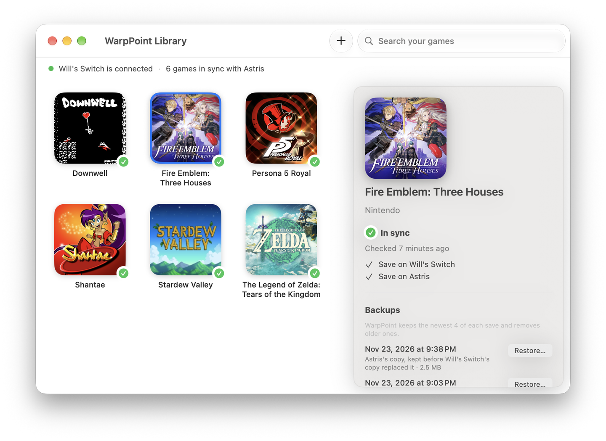
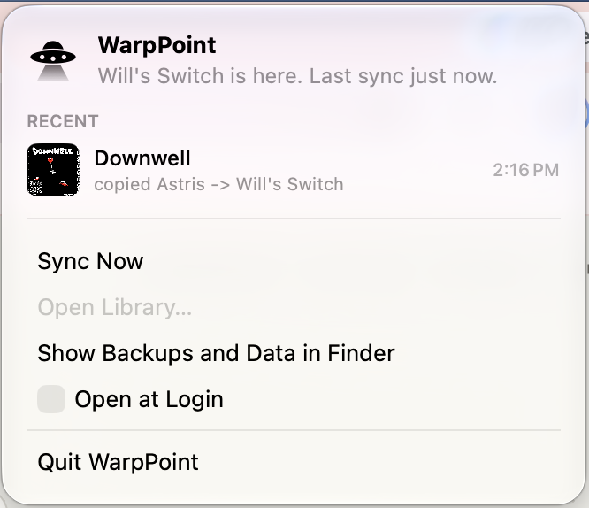
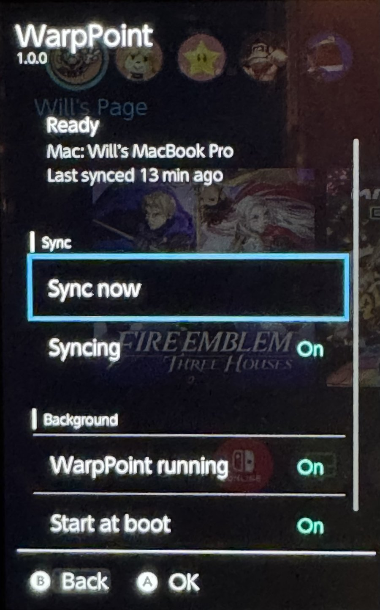

<h1 align="center">
  
  
</h1>

<p align="center">
  
</p>

<p align="center">
  Keeps your Nintendo Switch saves and your Mac's Switch emulator in sync, on its own.<br>
  Play on the Switch, pick up on the Mac, then go back. Same save.
</p>

<p align="center">
  
</p>

WarpPoint is a small menu bar app for the Mac and a background module for the Switch. When both
are on the same Wi-Fi they find each other and copy each game's save to whichever side is behind.
There are no folders to pick and nothing to open. Close a game on one side, and a few seconds later
its save is on the other.

Version 1.0 works with Astris (and other Ryujinx-based emulators) on an Apple Silicon Mac, and a
Switch running [Atmosphère](https://github.com/Atmosphere-NX/Atmosphere). More is on the way.
Each emulator and each console plugs into the same sync engine, so Windows, Linux, more emulators
(nxnative ports included) and more consoles are planned. See the [roadmap](#roadmap).

## What it does

- **Syncs both ways by itself.** Close a game on the Switch and its save lands in Astris. Stop a
  game in Astris and its save goes to the Switch.
- **Asks when it isn't sure.** If a save changed on both sides since they last matched, WarpPoint
  lets you pick which one to keep.
- **Backs up first.** Before it replaces a save anywhere, it keeps a copy on the Mac. It holds the
  newest 4 of each save, and any of them can be restored.
- **Writes all or nothing.** A new save goes into a scratch copy and becomes the real one in a
  single step, on the Switch and in Astris. If the power or the Wi-Fi drops halfway, you still
  have the old save.
- **Waits for you to finish playing.** A save is never touched while its game is running.
- **Brings games over.** Pick any game you've played on the Switch, and WarpPoint sets up its save
  in Astris, even if you've never launched it there.

## Install

**On the Mac** (Apple Silicon, macOS 14 or later)

1. Download `WarpPoint-1.0.1.dmg` from [Releases](../../releases) and drag WarpPoint into
   Applications.
2. Open it. The app isn't notarized by Apple yet, so macOS will block it the first time. Go to
   **System Settings → Privacy & Security** and click **Open Anyway**.
3. When macOS asks whether WarpPoint can find devices on your local network, click **Allow**.
   That's how it hears your Switch.

**On the Switch** (Atmosphère, plus [Tesla](https://github.com/WerWolv/Tesla-Menu) or another
overlay menu for the overlay)

1. Unzip `WarpPoint-Switch-1.0.1.zip` onto the root of the SD card. It adds the background module
   (`atmosphere/contents/4200000000005750/`, set to start at boot), the overlay
   (`switch/.overlays/warppoint.ovl`) and the app (`switch/warppoint.nro`).
2. Restart the Switch.

Back on the Mac, a setup window walks you through the rest. It finds Astris, waits for the Switch,
and asks which Astris profile goes with which Switch user.

Rather not have anything running in the background? Delete
`atmosphere/contents/4200000000005750/` and open **WarpPoint** from the homebrew menu whenever you
want to sync. The app and the background module can't run at the same time.

## Using it

Mostly, you don't. On the Mac, WarpPoint lives in the menu bar. Click the UFO to see what it's
doing and what it last moved.

<p align="center">
  
</p>

**Open Library…** shows the games WarpPoint keeps in sync.

- **+ Add Game** lists the games on your Switch that aren't in Astris yet. Pick one to bring its
  save over.
- Click a game for its status and its backups, and **Restore…** to put an older save back.
- Right-click a game to sync it now, find its save in Finder, or stop syncing it. Nothing gets
  deleted.

On the Switch, the WarpPoint overlay (open your overlay menu in any game) shows whether it's
running and when it last synced. It also has **Sync now**, a pause switch, and switches to run it
and start it at boot.

<p align="center">
  
</p>

## How light is it?

Light enough to forget about.

| | Mac app | Switch module |
|---|---|---|
| Memory | about 19 MB | a little over 2 MB, fixed at build time |
| CPU while idle | about 0.1% of one core | wakes once a second, otherwise asleep |
| Download | 1.4 MB | 0.5 MB, plus a 0.3 MB overlay |

Measured on an M2 Pro MacBook Pro and a launch-day Switch. The Mac app only does real work during
a sync, when it reads the saves on both sides to see what changed.

## Limits of 1.0

- The Switch has to be awake to sync. A sleeping Switch catches up when it wakes.
- WarpPoint can't create a save on the Switch yet. A game you've only played on the Mac waits until
  you've started it once on the Switch, and then you pick which save to keep.
- Adding a new game's save to Astris needs Astris to be closed, because Astris keeps its list of
  saves in memory while it runs. Saves it already has sync with Astris open.
- Very large saves (tens of MB) may not fit in a single write on the Switch.
- Mac only, and Ryujinx-family emulators only, for now.

## Roadmap

- [x] Sync both ways between the Switch and Astris, on its own (1.0)
- [x] Menu bar app, library, backups and restore, first-run setup (1.0)
- [x] Background module and Tesla overlay on the Switch (1.0)
- [ ] Create a save on the Switch for a game only played on the Mac
- [ ] Very large saves (TotK-size) written to the Switch in pieces
- [ ] nxnative ports and more emulators
- [ ] Windows and Linux
- [ ] A signed and notarized Mac app

## How it works

```
Mac                                                   Switch
┌──────────────────────────────────────────┐          ┌───────────────────────────┐
│ Menu bar app (Swift)                     │          │ Background module (C++)   │
│   │  C interface: host/capi/warp_core.h  │   Wi-Fi  │   reads and writes saves  │
│ Engine (C++): AutoSync → SyncEngine      │◄────────►│   through the console's   │
│   ├── Astris store (save index + folders)│  TCP     │   own save service, the   │
│   └── Switch store (talks to the Switch) │  + UDP   │   one JKSV uses           │
└──────────────────────────────────────────┘          │ Tesla overlay: status and │
                                                      │   controls, via files     │
                                                      └───────────────────────────┘
```

- Both sides refer to a save by name, `game/<title id>/<user id>`, and each side looks up where
  that save lives on its own. The Mac never sends the Switch a file path.
- To decide what to copy, WarpPoint fingerprints each side's save (SHA-256 over its files) and
  compares both against the last version they agreed on. If one side changed, that side wins. If
  both did, it asks you.
- The Switch announces itself on the network every 2 seconds, along with a counter that goes up
  whenever a game closes. The Mac syncs when the Switch shows up and whenever that counter moves.
- Astris keeps each save in a numbered folder, with a committed copy (`0`) and a scratch copy
  (`1`), plus a save index (`imkvdb.arc`) that maps games to folders. WarpPoint writes the scratch
  copy first, then the committed one, and keeps the index in the emulator's own sort order.
- On the Mac, a running game shows up as the lock file Astris holds open in its save folder. On
  the Switch, WarpPoint asks the system which game is running.

Adding an emulator means writing one new "store" class in `host/`. Adding a console means
speaking the same protocol, defined in `common/messages.hpp`.

## Build from source

You need Xcode, CMake and Ninja (`brew install cmake ninja`), and for the Switch parts,
[devkitPro](https://devkitpro.org/wiki/Getting_Started) with `switch-dev`.

```sh
cmake -S . -B build -G Ninja && cmake --build build   # engine, `warp` CLI, tests
ctest --test-dir build --output-on-failure            # run the tests
app/mac/build.sh                                      # build-release/WarpPoint.app
(cd switch/sysmodule && make)                         # the background module (.nsp)
(cd switch/overlay && make)                           # the Tesla overlay (.ovl)
(cd switch/agent && make)                             # the app (.nro)
./make-release.sh                                     # everything for a release
```

`build/host/warp` is a command line for the same engine. Try `warp list`, `warp sync downwell`,
`warp watch` or `warp resolve "three houses" switch`, or run `warp` on its own to see the rest.

## Thanks

[devkitPro and libnx](https://devkitpro.org) for Switch homebrew,
[LibHac](https://git.ryujinx.app/projects/LibHac), whose source documents the save formats,
[JKSV](https://github.com/J-D-K/JKSV) for showing how saves are handled on the console, and
[nlohmann/json](https://github.com/nlohmann/json) and [doctest](https://github.com/doctest/doctest).

WarpPoint isn't affiliated with Nintendo. Use it with games you own.

## License

MIT, see [LICENSE](LICENSE). The one exception is the Tesla overlay in `switch/overlay/`, which is
GPL-2.0 (see [its LICENSE](switch/overlay/LICENSE)) because the libtesla library it's built on is
GPL-2.0.
