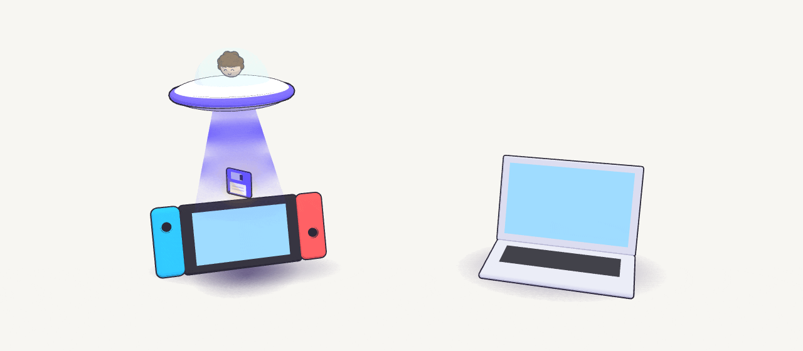
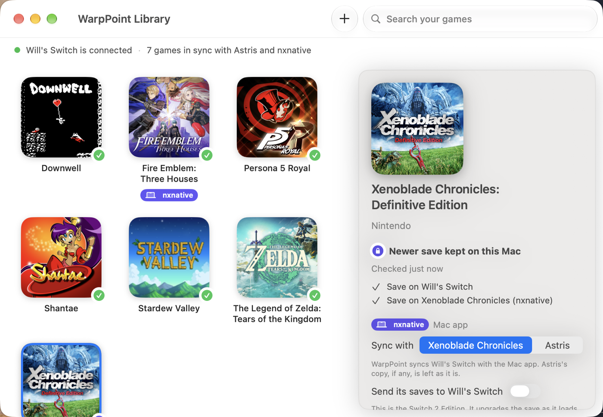

<h1 align="center">
  
  
</h1>

<p align="center">
  
</p>

<p align="center">
  Keeps your Nintendo Switch saves and your Mac's Switch games in sync, on its own.<br>
  Play on the Switch, pick up on the Mac, then go back. Same save.
</p>

<p align="center">
  
</p>

WarpPoint is a small menu bar app for the Mac and a background module for the Switch. When both
are on the same Wi-Fi they find each other and copy each game's save to whichever side is behind.
There are no folders to pick and nothing to open. Close a game on one side, and a few seconds later
its save is on the other.

Version 1.2 works with Astris (and other Ryujinx-based emulators) and with
[nxnative](https://github.com/seedds/nxnative) ports on an Apple Silicon Mac, and a Switch running
[Atmosphère](https://github.com/Atmosphere-NX/Atmosphere). Each Mac-side place and each console
plugs into the same sync engine, so Windows, Linux, more emulators and more consoles can follow.
See the [roadmap](#roadmap).

## What it does

- **Syncs both ways by itself.** Close a game on the Switch and its save lands in Astris. Stop a
  game in Astris and its save goes to the Switch.
- **Works with nxnative ports too (new in 1.2).** A game you've packed with nxnative runs as its
  own Mac app, and WarpPoint syncs it with your Switch the same way. Quit the app and its save goes
  to the Switch; close the game on the Switch and the app has it next time you open it.
- **Asks when it isn't sure.** If a save changed on both sides since they last matched, WarpPoint
  lets you pick which one to keep.
- **Backs up first.** Before it replaces a save anywhere, it keeps a copy on the Mac. It holds the
  newest 4 of each save, plus any you pin, and any of them can be restored.
- **Writes all or nothing.** A new save goes into a scratch copy and becomes the real one in a
  single step, on the Switch and in Astris. If the power or the Wi-Fi drops halfway, you still
  have the old save.
- **Waits for you to finish playing.** A save is never touched while its game is running.
- **Brings games over, both ways.** Pick any game you've played on the Switch, and WarpPoint sets up
  its save in Astris, even if you've never launched it there. A game you've only played on the Mac
  gets its save made on the Switch (1.3), sized the way the game asks, as long as it's installed
  there.

## Install

**On the Mac** (Apple Silicon, macOS 14 or later)

1. Download `WarpPoint-1.7.0.dmg` from [Releases](../../releases) and drag WarpPoint into
   Applications.
2. Open it. The app isn't notarized by Apple yet, so macOS will block it the first time. Go to
   **System Settings → Privacy & Security** and click **Open Anyway**.
3. When macOS asks whether WarpPoint can find devices on your local network, click **Allow**.
   That's how it hears your Switch.

**On the Switch** (Atmosphère, plus [Tesla](https://github.com/WerWolv/Tesla-Menu) or another
overlay menu for the overlay)

1. Unzip `WarpPoint-Switch-1.7.0.zip` onto the root of the SD card. It adds the background module
   (`atmosphere/contents/4200000000005750/`, set to start at boot), the overlay
   (`switch/.overlays/warppoint.ovl`) and the app (`switch/warppoint.nro`).
2. Restart the Switch.

Back on the Mac, a setup window walks you through the rest. It finds Astris and any nxnative
apps, waits for the Switch, and asks which Astris profile goes with which Switch user (and whose
saves the nxnative apps hold). No Astris? nxnative apps alone are enough.

Rather not have anything running in the background? Delete
`atmosphere/contents/4200000000005750/` and open **WarpPoint** from the homebrew menu whenever you
want to sync. The app and the background module can't run at the same time.

## Using it

Mostly, you don't. On the Mac, WarpPoint lives in the menu bar. Click the UFO to see what it's
doing and what it last moved.

<p align="center">
  
</p>

**Open Library…** shows the games WarpPoint keeps in sync.

- **+ Add Game** lists the games on your Switch that aren't in Astris yet. Pick one to bring its
  save over.
- Click a game for its status and its backups, and **Restore…** to put an older save back. Give a
  backup a note ("before the final boss") and pin it to keep it forever (1.5).
- Right-click a game to sync it now, find its save in Finder, or stop syncing it. Nothing gets
  deleted.
- For games WarpPoint can read, the details start with **Save Slots**: each slot's chapter, play
  time and player, read from the save on the Mac, so you can see where you are without starting
  the game. While the game runs on the Switch, a **Live** section adds Tap's numbers. Fire Emblem:
  Three Houses is the first; see [docs/SAVE_PREVIEWS.md](docs/SAVE_PREVIEWS.md).

On the Switch, the WarpPoint overlay (open your overlay menu in any game) shows whether it's
running and when it last synced. It also has **Sync now**, a pause switch, and switches to run it
and start it at boot.

<p align="center">
  
</p>

## nxnative ports

[nxnative](https://github.com/seedds/nxnative) turns a Switch game you own into a native Mac app.
WarpPoint 1.2 finds those apps on its own and treats each one as the Mac-side home of that game's
save. Nothing to set up beyond picking, once, which Switch user the apps' saves belong to.

<p align="center">
  
</p>

- **Found automatically.** Any nxnative app in `/Applications` or `~/Applications` (or one folder
  below) shows up in the library with an **nxnative** badge, under the game's own name and icon.
- **The right save, even for Switch 2 Editions.** An nxnative app is named after its own title ID,
  which for a Switch 2 Edition differs from the save the console keeps (Xenoblade Chronicles DE's
  app is `0400FF500E34A001`, its Switch save is `0100FF500E34A000`). WarpPoint reads the app's own
  control data (`SaveDataOwnerId` in `control.nacp`) to pair them, so no table is needed.
- **A fresh install just works.** Install the app, and the next sync copies your Switch save into
  it, even if you've never opened it.
- **Same safety rules.** The app's save is only touched while the app is closed. A new save is
  built next to the old one and swapped in with a single rename, the way nxnative commits its own
  saves. The copy being replaced is backed up first, and can be restored from the library.
- **Astris and nxnative side by side.** If a game is in both, WarpPoint syncs the Switch with the
  nxnative app, and you can switch it back to Astris in the game's details. When a game changes
  places, WarpPoint compares the two saves fresh: an empty app gets the Switch's save, and two
  different saves ask you which one to keep. It never guesses from the old place's history.
- **nxnative's own iCloud saves.** If a game has nxnative's cloud saves turned on, WarpPoint says so
  in the library and leaves nxnative's `.sync` / `.dmsync` files alone. The app sends WarpPoint's
  save to iCloud on its next start, since only the local copy changed.

- **Switch 2 Editions go one way.** A Switch 2 Edition app upgrades the save it loads, and the
  Switch 1 version of the game crashes on the result. So WarpPoint brings your Switch save into a
  Switch 2 Edition app, but keeps the app's newer saves on the Mac ("Newer save kept on this
  Mac") instead of sending them to a Switch 1. If your console can read them, turn on **Send its
  saves to** your console in the game's details.

Tested on a Switch 1 with Fire Emblem: Three Houses (a mid-battle bookmark carried both ways,
checked in-game on both sides) and Xenoblade Chronicles: Definitive Edition, whose Switch 2
Edition app on the Mac shares the Switch 1 game's save. `warp nxnative` lists the apps WarpPoint
found and the save each one maps to, and `warp restore` puts any backup back on either side.

## More than saves (1.3)

The link WarpPoint keeps between the Switch and the Mac carries a few more things. Each is
its own capability on the Switch side, so an older Switch module just doesn't offer it.

- **Warp Lens: crash reports.** When a game or app crashes on the Switch, Atmosphère writes a
  report to the SD card. WarpPoint brings new ones to the Mac after the next sync, says in plain
  words what happened ("Xenoblade Chronicles crashed (2168-0002). It read or wrote memory it
  shouldn't have…"), and keeps the report and the screenshot of the crash. **Crash Reports…** in
  the menu lists them; a notification says when there's a new one. Error reports that are only
  Wi-Fi noise are skipped. `warp reports` does the same from a terminal.
- **Warp Album: screenshots and videos.** New captures from the Switch's album land in
  `~/Pictures/WarpPoint/<Game>/` after each sync, named by game and time. The first time, the
  last 30 days come over. Change the folder or turn it off in Settings. Nothing on the Switch is
  changed. `warp album` copies new ones now.
- **Warp Presence: Discord.** Discord shows the game you're playing on the Switch. Discord needs
  an app of your own for this: make one at
  [discord.com/developers/applications](https://discord.com/developers/applications) (call it
  "Nintendo Switch"), paste its Application ID into Settings › Discord, and turn it on. The menu
  shows what's playing on the Switch either way. `warp presence-test ID` checks the ID.

## Live game info, mods and speedruns (1.4)

- **Warp Tap: live game info.** **Live Game Info…** in the menu shows numbers from the game
  running on the Switch, read-only, updating every 2 seconds. Fire Emblem: Three Houses 1.2.0
  comes with gold, renown, and the level and HP of the unit under the battle cursor. Other games
  and versions need a profile, a small JSON file; see
  [docs/TAP_PROFILES.md](docs/TAP_PROFILES.md). `warp tap` in a terminal.
- **Warp Mods: one mod library.** A game's details card has a **Mods** section. Add a mod's
  folder, switch it on, and at the next sync it goes to the Switch
  (`atmosphere/contents/<game>/`) and to this Mac's copy: Astris's mods folder, or an nxnative
  app's RomFS overlay. WarpPoint only ever removes files it put there, leaves mods you installed
  yourself alone, and tells you when two mods change the same file. `warp mods` in a terminal.
- **Warp Split: LiveSplit.** With LiveSplit's TCP server on (Control › Start TCP Server) and
  Settings › LiveSplit on, WarpPoint starts, splits, resets and pauses the timer by the rules in
  the running game's Tap profile. For practice on real hardware.
- **Warp Lexicon: game text.** **Lexicon…** shows the game's current line of text live, keeps
  the earlier ones, lets you select words for macOS Look Up and Translate, and saves lines for
  Anki. Fire Emblem: Three Houses 1.2.0's dialogue is built in (1.7); other games need a profile
  with a text field marked `"lexicon"`.

Also in 1.4: the Switch remembers each save's hash until the save changes, so syncing no longer
opens a game's save just as that game starts (which could make the game close with "an error
occurred"). Passes after the first are about four times faster.

## Labs (1.6)

Developer tools, terminal only. **Divergence** reads the same Tap profile from the game on
the Switch and from the same game in an nxnative app on this Mac, and shows where they differ.
`warp lab-run` presses the same buttons on both and stops at the first field that differs. It's
also the quick way to find new Tap fields: search the Mac port's memory, then check the chain on
the Switch.
See [docs/LABS.md](docs/LABS.md).

## How light is it?

Light enough to forget about.

| | Mac app | Switch module |
|---|---|---|
| Memory | about 19 MB | a little over 2 MB, fixed at build time |
| CPU while idle | about 0.1% of one core | wakes once a second, otherwise asleep |
| Download | 1.4 MB | 0.5 MB, plus a 0.3 MB overlay |

Measured on an M2 Pro MacBook Pro and a launch-day Switch. The Mac app only does real work during
a sync, when it reads the saves on both sides to see what changed.

## Limits

- The Switch has to be awake to sync. A sleeping Switch catches up when it wakes.
- To make a save on the Switch for a game you've only played on the Mac, the game has to be
  installed on the Switch. Until it is, the save waits on the Mac.
- Adding a new game's save to Astris needs Astris to be closed, because Astris keeps its list of
  saves in memory while it runs. Saves it already has sync with Astris open.
- A save bigger than its own journal is written to the Switch in pieces. If the power goes in the
  middle, WarpPoint counts that save as missing on the Switch and writes it again on the next
  sync; the old one is in the Mac's backups.
- Mac only, and Ryujinx-family emulators and nxnative apps only, for now.
- An nxnative app's main player is synced. Extra local players (nxnative's `save_userN` folders)
  are left alone.
- A Switch 2 Edition app upgrades the save as it loads it, and the Switch 1 version of the game
  crashes on the upgraded save (tested with Xenoblade Chronicles DE). So saves made in a Switch 2
  Edition app stay on the Mac and are never sent to a Switch 1. Your Switch's saves still come to
  the Mac. Details in [docs/NXNATIVE_SUPPORT.md](docs/NXNATIVE_SUPPORT.md).

## Roadmap

- [x] Sync both ways between the Switch and Astris, on its own (1.0)
- [x] Menu bar app, library, backups and restore, first-run setup (1.0)
- [x] Background module and Tesla overlay on the Switch (1.0)
- [x] Create a save on the Switch for a game only played on the Mac (1.3)
- [x] Very large saves written to the Switch in pieces (1.3)
- [x] Warp Lens: crash reports from the Switch, on the Mac, explained (1.3)
- [x] Warp Album: Switch screenshots and videos into a Mac folder (1.3)
- [x] Warp Presence: what's playing on the Switch, in Discord (1.3)
- [x] Warp Tap: live, read-only game info, with game profiles (1.4)
- [x] Warp Mods: one mod library for the Switch, Astris and nxnative apps (1.4)
- [x] Warp Split: LiveSplit auto-splitting from Tap (1.4)
- [x] Warp Lexicon: the game's text in a Mac window, for Look Up and Anki (1.4)
- [x] Warp Chronicle: notes on backups, and pinned backups kept forever (1.5)
- [x] Labs: Divergence, the Switch against an nxnative port, field by field (1.6, terminal only)
- [x] FE3H dialogue in Lexicon (1.7, found with Labs on the Mac port, checked on a Switch)
- [ ] More Tap profiles: other games, and FE3H's roster and supports
- [ ] Labs: Tracy, a profiler for retail games on hardware
- [ ] Shader pre-warming for emulators (on hold: nxnative ports already ship their shaders)
- [x] nxnative ports, found and synced like emulator games (1.2)
- [ ] More emulators
- [ ] Windows and Linux
- [ ] A signed and notarized Mac app

## How it works

```
Mac                                                   Switch
┌──────────────────────────────────────────┐          ┌───────────────────────────┐
│ Menu bar app (Swift)                     │          │ Background module (C++)   │
│   │  C interface: host/capi/warp_core.h  │   Wi-Fi  │   reads and writes saves  │
│ Engine (C++): AutoSync → SyncEngine      │◄────────►│   through the console's   │
│   ├── Mac store: picks one per game      │  TCP     │   own save service, the   │
│   │    ├── Astris (save index + folders) │  + UDP   │   one JKSV uses           │
│   │    └── nxnative apps (save/ folders) │          │ Tesla overlay: status and │
│   └── Switch store (talks to the Switch) │          │   controls, via files     │
└──────────────────────────────────────────┘          └───────────────────────────┘
```

- Both sides refer to a save by name, `game/<title id>/<user id>`, and each side looks up where
  that save lives on its own. The Mac never sends the Switch a file path.
- To decide what to copy, WarpPoint fingerprints each side's save (SHA-256 over its files) and
  compares both against the last version they agreed on. If one side changed, that side wins. If
  both did, it asks you.
- The Switch announces itself on the network every 2 seconds, along with a counter that goes up
  whenever a game closes. The Mac syncs when the Switch shows up and whenever that counter moves.
- Astris keeps each save in a numbered folder, with a committed copy (`0`) and a scratch copy
  (`1`), plus a save index (`imkvdb.arc`) that maps games to folders. WarpPoint writes the scratch
  copy first, then the committed one, and keeps the index in the emulator's own sort order.
- An nxnative app keeps its save as plain files in
  `~/Library/Application Support/nxnative/<app title id>/save/`, in the console's own format.
  WarpPoint reads `save/` (never the game's scratch copy, `save.work/`), and writes by swapping a
  whole new `save/` in with one `renamex_np(RENAME_SWAP)`.
- On the Mac, a running game shows up as the lock file Astris holds open in its save folder, or as
  a process running from inside an nxnative app. On the Switch, WarpPoint asks the system which
  game is running.

Adding an emulator means writing one new "store" class in `host/` (`nxnative_store.cpp` is the
newest example). Adding a console means
speaking the same protocol, defined in `common/messages.hpp`.

## Build from source

You need Xcode, CMake and Ninja (`brew install cmake ninja`), and for the Switch parts,
[devkitPro](https://devkitpro.org/wiki/Getting_Started) with `switch-dev`.

```sh
cmake -S . -B build -G Ninja && cmake --build build   # engine, `warp` CLI, tests
ctest --test-dir build --output-on-failure            # run the tests
app/mac/build.sh                                      # build-release/WarpPoint.app
(cd switch/sysmodule && make)                         # the background module (.nsp)
(cd switch/overlay && make)                           # the Tesla overlay (.ovl)
(cd switch/agent && make)                             # the app (.nro)
./make-release.sh                                     # everything for a release
```

`build/host/warp` is a command line for the same engine. Try `warp list`, `warp sync downwell`,
`warp watch`, `warp resolve "three houses" switch`, `warp nxnative`, `warp backups xenoblade`,
`warp reports`, `warp album`, `warp tap` or `warp mods TITLE_ID`, or run `warp` on its own to see
the rest.

## Thanks

[devkitPro and libnx](https://devkitpro.org) for Switch homebrew,
[LibHac](https://git.ryujinx.app/projects/LibHac), whose source documents the save formats,
[JKSV](https://github.com/J-D-K/JKSV) for showing how saves are handled on the console, and
[nlohmann/json](https://github.com/nlohmann/json) and [doctest](https://github.com/doctest/doctest).

WarpPoint isn't affiliated with Nintendo. Use it with games you own.

## License

MIT, see [LICENSE](LICENSE). The one exception is the Tesla overlay in `switch/overlay/`, which is
GPL-2.0 (see [its LICENSE](switch/overlay/LICENSE)) because the libtesla library it's built on is
GPL-2.0.
