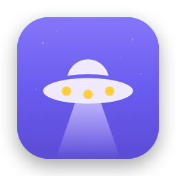

<p align="center">
  
</p>

<h1 align="center">WarpPoint</h1>

<p align="center">
  Keeps your Nintendo Switch saves and your Mac's Switch emulator in sync, on its own.<br>
  Play on the Switch, pick up on the Mac, then go back. Same save.
</p>

<p align="center">
  
</p>

WarpPoint is a small menu bar app for the Mac plus a homebrew app for the Switch. While both are
on the same Wi-Fi, they find each other and copy each game's save to whichever side is behind.
You never pick files or folders: WarpPoint knows where every game keeps its save on both sides.

**Version 0.7** works with Astris (and other Ryujinx-based
emulators) on an Apple Silicon Mac, and a Switch running [Atmosphère](https://github.com/Atmosphere-NX/Atmosphere).

## What it does

- **Syncs on its own.** When you open WarpPoint on the Switch, the Mac notices and syncs. When
  you stop a game in Astris, its save goes to the Switch a couple of seconds later.
- **Never guesses.** If a save changed on both sides since they last agreed, WarpPoint asks
  which one to keep instead of picking.
- **Backs up before it overwrites anything,** on either side. The newest 4 backups of each save
  are kept on the Mac, and any of them can be restored.
- **Never leaves half a save.** Writes land in a scratch copy first and become the real save in
  one step, on the Switch and in Astris, so a crash or a dropped connection leaves the old save.
- **Leaves running games alone.** A game's save is never touched while that game is running.
- **Brings games over.** Pick any game you've played on the Switch and WarpPoint creates its
  save in Astris, even if you've never launched it there.

<p align="center">
  
</p>

## Install

**On the Mac** (Apple Silicon, macOS 14 or later):

1. Download `WarpPoint-0.7.0.dmg` from [Releases](../../releases) and drag WarpPoint to Applications.
2. Open it. This build isn't signed with an Apple developer certificate yet, so macOS will
   refuse the first time: open **System Settings → Privacy & Security** and click **Open Anyway**.
3. When macOS asks whether WarpPoint may find devices on your local network, click **Allow**.
   That's how it hears your Switch.

**On the Switch** (Atmosphère):

1. Copy `warppoint.nro` from the same release into `/switch/` on the SD card.
2. Open the homebrew menu and start **WarpPoint**. For full memory, open the homebrew menu
   by holding **R** while starting any game.

A setup window then walks you through the rest: it finds Astris, waits for the Switch, and asks
which Astris profile goes with which Switch user.

## Using it

Keep WarpPoint open on the Switch while you want to sync; the Mac app does everything else from
the menu bar. Click the UFO for status and recent syncs, or **Open Library…** for your games:

- **+ Add Game** lists the games on your Switch that aren't in Astris yet. Pick one to bring its
  save over.
- **Click a game** for its status and backups, and **Restore…** to put an older save back.
- **Right-click a game** to sync now, show its save in Finder, or stop syncing it (nothing is
  deleted).

## Limits of 0.7

- **The WarpPoint app has to be open on the Switch** to sync. A background version with a Tesla
  overlay is planned for 1.0.
- **WarpPoint can't create a save on the Switch yet.** A game you've only played on the Mac
  waits quietly until you've started it once on the Switch; then you pick which save to keep.
- **New saves in Astris need Astris quit,** because Astris keeps its list of saves in memory
  while it's open. Syncing saves it already has works with Astris open.
- Very large saves (tens of MB) may not fit in one write on the Switch.
- Mac only, and Ryujinx-family emulators only, for now.

## How it works

```
Mac                                                   Switch (homebrew app)
┌──────────────────────────────────────────┐          ┌───────────────────────────┐
│ Menu bar app (Swift)                     │          │ WarpPoint .nro (C++)      │
│   │  C interface: host/capi/warp_core.h  │   Wi-Fi  │   reads and writes saves  │
│ Engine (C++): AutoSync → SyncEngine      │◄────────►│   through the console's   │
│   ├── Astris store (save index + folders)│  TCP     │   own save service, the   │
│   └── Switch store (talks to the .nro)   │  + UDP   │   one JKSV uses           │
└──────────────────────────────────────────┘          └───────────────────────────┘
```

- **Saves are named, not located.** Both sides call a save `game/<title id>/<user id>`. The Mac
  never sends the Switch a file path; each side looks up where that save lives.
- **Deciding** is a small pure function: each side's current fingerprint (a SHA-256 over the
  save's files) against the last one both sides agreed on. One side changed: copy it. Both
  changed: ask.
- **Discovery**: the Switch app announces itself on the network every 2 seconds; the Mac listens.
- **Astris** keeps each save in a numbered folder with a committed copy (`0`) and a scratch copy
  (`1`), and a save index (`imkvdb.arc`) that says which folder belongs to which game. WarpPoint
  writes both copies, scratch first, and adds index rows in the emulator's own sort order.
- **A running game** is detected by the lock file Astris holds open in that game's save folder.

The engine is built to be extended: a new emulator is one new "store" class (`host/`), and a new
console is anything that speaks the same protocol (`common/messages.hpp`).

## Build from source

You need Xcode, CMake and Ninja (`brew install cmake ninja`), and for the Switch app,
[devkitPro](https://devkitpro.org/wiki/Getting_Started) with `switch-dev`.

```sh
cmake -S . -B build -G Ninja && cmake --build build   # engine, `warp` CLI, tests
ctest --test-dir build --output-on-failure            # run the tests
app/mac/build.sh                                      # build-release/WarpPoint.app
(cd switch/agent && make)                             # switch/agent/warppoint.nro
app/mac/make-dmg.sh                                   # everything for a release
```

`build/host/warp` is a command line for the same engine: `warp list`, `warp sync downwell`,
`warp watch`, `warp resolve "three houses" switch`, and more (`warp` alone shows them).

## Thanks

[devkitPro and libnx](https://devkitpro.org) for Switch homebrew,
[LibHac](https://git.ryujinx.app/projects/LibHac) (the save formats were read from its source),
[JKSV](https://github.com/J-D-K/JKSV) for showing how saves are handled on the console,
[nlohmann/json](https://github.com/nlohmann/json) and [doctest](https://github.com/doctest/doctest).

WarpPoint is not affiliated with Nintendo. Use it with games you own.

## License

MIT. See [LICENSE](LICENSE). The exception is the Tesla overlay in `switch/overlay/`, which is
GPL-2.0 (see [its LICENSE](switch/overlay/LICENSE)) because it's built on
[libtesla](https://github.com/WerWolv/libtesla), which is GPL-2.0.
